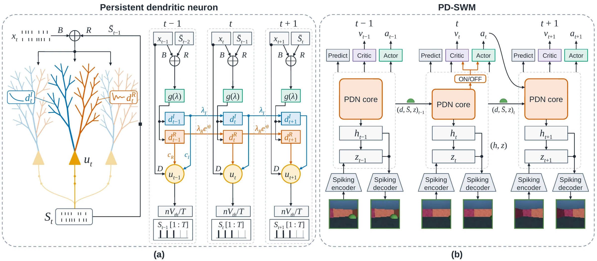

Spiking neural network (SNN) world models approach the control performance of ANN world models, but they struggle to recall cues from the distant past. We trace this to two core problems of existing spiking neurons. Over time, distant inputs leave traces that are too weak, and the times at which inputs occurred are hard to tell apart. At readout, resetting the state at firing overwrites the stored memory.

PD-SWM is an SNN world model built on Persistent Dendritic Neurons (PDNs). Their dendrites store the memory in damped oscillating channels whose phases mark when inputs occurred, a normalized write gain keeps distant traces strong, and the soma reads the dendrites out as spikes at every step without resetting them.

- On BSuite memory length, PD-SWM is the only model that succeeds at every length from 8 to 101 steps. DreamerV3 stops at 51 steps under the same budget.
- On POPGym RepeatPrevious Medium, 72% of its answers name the card from 32 steps earlier, while every other model stays close to the 25% chance level.
- In Memory Maze, it locates objects that have left the view more accurately than the spiking baselines and DreamerV3.
- Predicting walker walk 45 frames ahead from actions alone, it has the lowest pixel error of all models.

<a href="/pdswm/" class="btn btn--primary btn--large">View the visual project showcase →</a> <a href="https://github.com/wxqnl/PD-SWM" class="btn btn--inverse btn--large">Code on GitHub</a>
